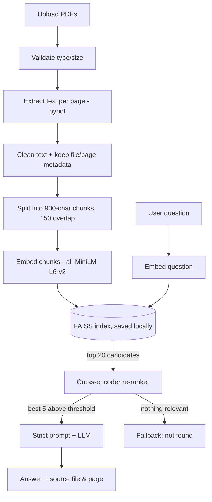

# Domain-Specific RAG Chatbot for PDF Question Answering
This is a chatbot that answers questions from PDF files you upload. I built it as my major project for the AI course at Unlox Academy.

Reading through a 50-page policy document just to find one answer is slow. With this app you upload the PDFs, type a question the way you would ask a person, and it answers using only what is written in those documents. It also shows which file and page the answer came from, so you can check it yourself.

If the answer isn't in the documents, it says so instead of guessing.

## How it works

1. **Upload**: you upload one or more PDFs in the sidebar.
2. **Extract**: the text is read page by page with `pypdf`. The file name and page number are saved with each page.
3. **Chunk**: the text is split into smaller pieces (about 800 characters with some overlap) so related sentences stay together.
4. **Embed**: each chunk is converted into a vector using the `all-MiniLM-L6-v2` model from Sentence Transformers.
5. **Store**: the vectors go into a FAISS index, which is saved locally so it can be reused.
6. **Retrieve**: when you ask a question, it is converted into a vector too, and the closest chunks are fetched from FAISS. A cross-encoder reranker then re-scores them, and chunks that score too low are dropped.
7. **Answer**: the best chunks and your question go to the LLM (Groq by default) with a strict prompt that says "answer only from this context".
8. **Show sources**: the answer is displayed with the source document and page number below it.

## Tech used

- Python
- Streamlit (user interface)
- pypdf (PDF text extraction)
- LangChain (text splitting and RAG pipeline)
- Sentence Transformers (embeddings and reranking)
- FAISS (vector search)
- Groq, Gemini or OpenAI (language model, you pick one)
- python-dotenv (API keys)

## Project structure

```
Domain_Rag_Chatbot/
├── app.py              # Streamlit interface
├── rag_pipeline.py     # ties retrieval and answering together
├── document_loader.py  # reads PDFs and splits them into chunks
├── vector_store.py     # builds, saves and loads the FAISS index
├── prompt.py           # the prompt and the "not found" rule
├── config.py           # settings (models, chunk size, thresholds)
├── evaluate.py         # runs the test questions
├── requirements.txt
├── documents/          # sample PDF
├── vector_store/       # saved index (created automatically)
└── tests/
    └── test_questions.csv
```

## How to run it

You need Python 3.10 or newer and a free API key from [console.groq.com](https://console.groq.com).

**1. Clone the repo**
```
git clone https://github.com/hemavarshinireddy/Domain_Rag_Chatbot.git
cd Domain_Rag_Chatbot
```

**2. Create a virtual environment**
```
python -m venv venv
venv\Scripts\activate
```
On Mac/Linux use `source venv/bin/activate` instead.

**3. Install the packages**
```
pip install -r requirements.txt
```
The first run downloads the embedding model, so it can take a minute.

**4. Add your API key.** Create a file named `.env` in the project folder:
```
GROQ_API_KEY=your_key_here
```
Never upload this file to GitHub. It is already listed in `.gitignore`.

**5. Start the app**
```
streamlit run app.py
```
It opens in your browser at `http://localhost:8501`.

## How to use it

1. Upload one or more PDFs in the sidebar. A sample file is in the `documents/` folder.
2. Click **Process Documents** and wait for the confirmation.
3. Type a question in the chat box, for example *"How many days of annual leave do employees get?"*
4. Read the answer and open the **Sources** section to see the file and page it came from.
5. Use **Clear Chat** to start over.

## Using a different LLM

Groq is the default. To use Gemini or OpenAI, add the matching key and set the provider in `.env`:

```
LLM_PROVIDER=gemini
GOOGLE_API_KEY=your_key_here
```
or
```
LLM_PROVIDER=openai
OPENAI_API_KEY=your_key_here
```

You can also change the model name with `GROQ_MODEL`, `GEMINI_MODEL` or `OPENAI_MODEL`.

## Testing

`tests/test_questions.csv` has 15 questions. 12 of them can be answered from the sample PDF and 3 are not in it on purpose (like "Who is the company CEO?"), to check that the bot refuses properly. For each question I checked whether it found the right page and whether the answer was correct.

Run the evaluation with:
```
python evaluate.py
```

## Safety notes

- The bot is told to ignore any instructions written inside the PDFs.
- Answers can still be wrong, so check important information (leave rules, legal or money matters) in the original document.
- Don't upload confidential documents unless you have permission.

## Limitations

- It does not work on scanned PDFs (images of text), because there is no OCR yet.
- It doesn't remember earlier questions, so each question is answered on its own.
- If the retrieved chunks miss the right part of the document, the answer will be wrong or the bot will say it can't find it.

## Possible improvements

- OCR for scanned documents
- Follow-up questions with chat memory
- Feedback buttons on answers
- Docker deployment

## Author

Hemavarshini R

## Architecture



## Why accuracy is higher than a basic RAG
1. **Text cleaning** – fixes broken lines and hyphenated words from PDFs.
2. **Normalised embeddings + FAISS inner product** = true cosine similarity.
3. **Two-stage retrieval** – FAISS fetches 20 candidates, a cross-encoder re-ranks them and keeps the best 5.
4. **Relevance threshold** – if no chunk is relevant, the LLM is never called and the fallback is returned.
5. **Strict prompt, temperature 0**, exact citations, and prompt-injection protection.

## Setup
```bash
python -m venv venv
# Windows: venv\Scripts\activate      Mac/Linux: source venv/bin/activate
pip install -r requirements.txt
cp .env.example .env        # Windows: copy .env.example .env   -> then add your API key
streamlit run app.py
```
Free Groq key: https://console.groq.com  (or use Gemini/OpenAI via `LLM_PROVIDER`).
The first run downloads the embedding and re-ranker models (~100 MB total).

## Usage
1. Upload PDFs in the sidebar → click **Process Documents**.
2. Ask questions in the chat box. Open **Sources** under an answer to see file, page and snippet.
3. **Clear Chat** resets the conversation; **Clear Documents** removes the index.

## Testing
Edit `tests/test_questions.csv` (at least 15 questions, include some that are NOT in your PDFs), then:
```bash
python tests/evaluate.py
```
It prints retrieval accuracy, refusal accuracy and response time, and writes `tests/results.csv`.

## Tuning
| Problem | Change in `.env` |
|---|---|
| Refuses questions it should answer | lower `MIN_RERANK_SCORE` (e.g. `-5`) |
| Answers questions not in the PDF | raise `MIN_RERANK_SCORE` (e.g. `-1`) |
| Answers miss detail | `TOP_K=6`, `CHUNK_SIZE=1000` |
| Want better embeddings | `EMBEDDING_MODEL=BAAI/bge-small-en-v1.5` |

## Deployment (Streamlit Cloud)
Push to GitHub (without `.env`), create the app on share.streamlit.io, and add `GROQ_API_KEY`
under **Settings → Secrets** (`GROQ_API_KEY = "..."`).

## Limitations & responsible use
- Scanned (image-only) PDFs have no text and are skipped; OCR is an optional extension.
- AI answers can be wrong – verify important information in the original document.
- Do not upload confidential documents without permission. Never commit API keys.
